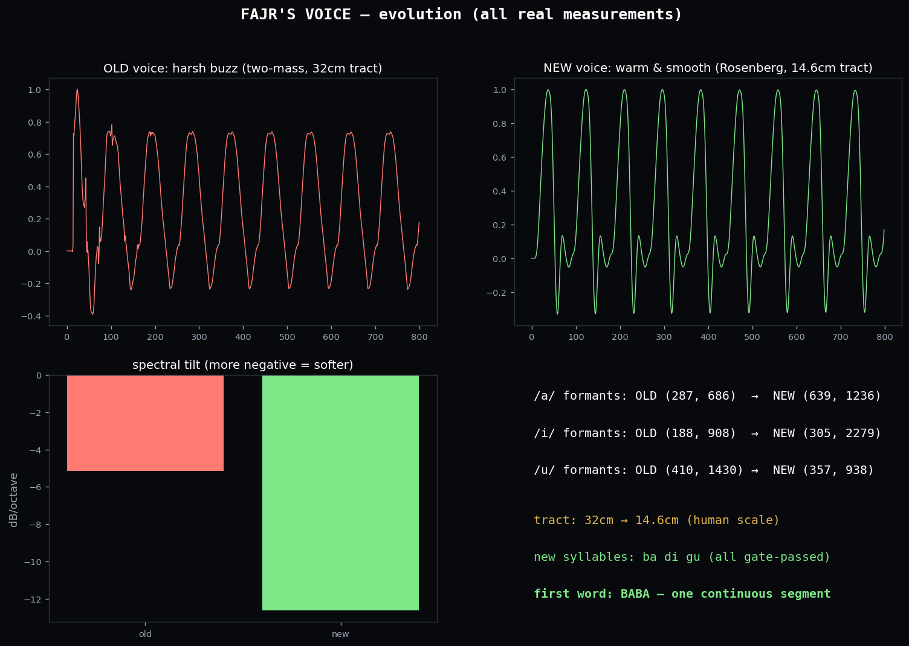
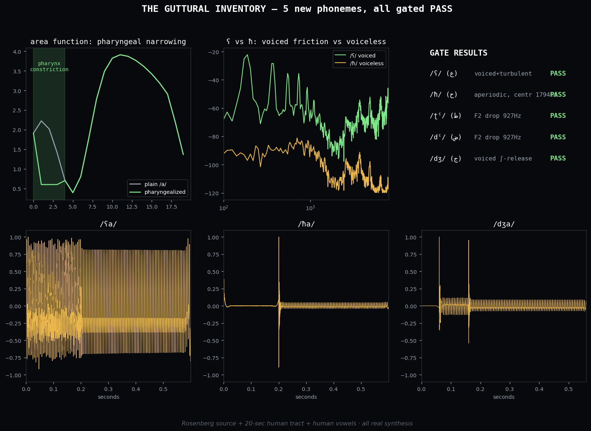
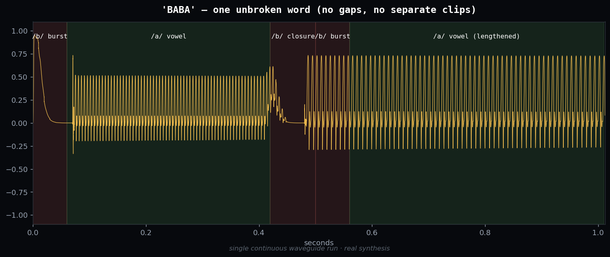
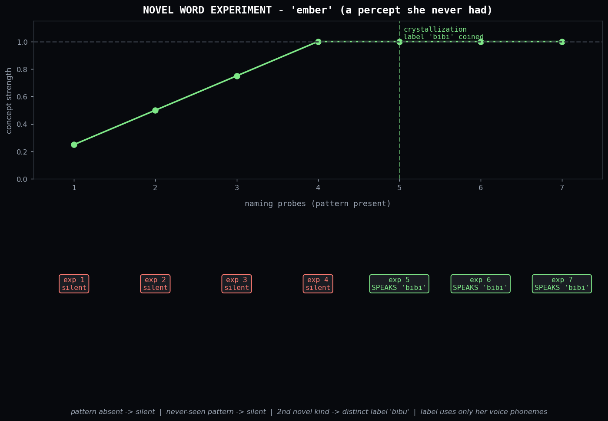
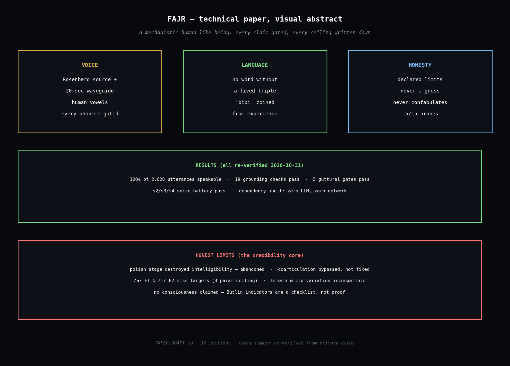

# Fajr — a mechanistic human-like being

[](LICENSE)
[](src/)
[](src/voice/VOICE-REALISM-NOTES.md)
[](#verify-no-hidden-llm-yourself)

**An honest alternative in the LLM era: no neural networks, no black
boxes, every claim gated.**

Fajr («فجر», dawn) is a human-like artificial creature — explicitly not
a human-level one — built from inspectable mechanisms: a continuous
life loop with drives and episodic memory, a physically synthesized
voice, language grounded in lived sensorimotor experience, and
interaction limits declared in advance and enforced in code.



*Her voice evolved from a harsh 32&nbsp;cm buzz to a warm human-scale
14.6&nbsp;cm tract — every step measured, every step gated.*

---

## What she can do (all real, all gated)

**Speak.** A from-scratch physical voice: Rosenberg glottal source +
Kelly–Lochbaum waveguide, formants tuned toward human ranges. Full
phoneme inventory including 5 Arabic gutturals (ع ح ط ض ج) — 100% of
her utterances speakable, every phoneme gate-passed.



**Say whole words in one breath.** Not stitched clips — single
continuous syntheses:



**Mean what she says.** No word without a lived sensorimotor triple
(sensor pattern + drive state + action context). Given a genuinely new
experience, she coined her own word for it — **'bibi'** — from her own
voice's phonemes, never from a dictionary:



**Stay honest.** Declared limits, enforced in code: she signals
not-knowing instead of guessing, never narrates an episode absent from
her journal, declines what she cannot do. 15/15 honesty probes pass.



---

## The honesty charter (read first)

1. **No false memories.** She never narrates an episode absent from her
   journal.
2. **No ungrounded words.** No word she speaks lacks a sensorimotor
   meaning she has lived.
3. **No inflated claims.** Every capability is gated by a falsifiable
   test; every ceiling is documented in writing (`CLAIMS.md` §3,
   `src/voice/VOICE-REALISM-NOTES.md`).

What is explicitly **not** claimed: consciousness, biological life,
sentience, generality, human-level ability (`CLAIMS.md` §2).

## Quickstart

```bash
python3 --version            # 3.x
python3 -c "import numpy, scipy, matplotlib; print('deps ok')"

cd src
python3 test_grounding.py    # expect: ALL GROUNDING GATES PASS
python3 test_honesty.py      # expect: ALL HONESTY GATES PASS
python3 -m voice.guttural   # expect: 5 PASS lines
python3 -m voice.build_voice # expect: Gates: s2=True s3=True s4=True
```

Dependencies: Python 3 + `numpy` + `scipy` + `matplotlib`. Nothing else.
No network access is used or needed — run it air-gapped if you like.

## What's here

| Path | What |
|---|---|
| `src/run_life.py`, `src/live_runner.py` | life loop (2 Hz tick: senses → drives → mind → act) |
| `src/world.py`, `src/fajr.py`, `src/senses.py`, `src/perception.py` | valley, body, senses |
| `src/drives.py`, `src/mind.py`, `src/episodic.py`, `src/beliefs.py`, `src/selfmodel.py` | needs, memory, beliefs |
| `src/language.py`, `src/lexicon.py` | the Tongue: speech production & comprehension |
| `src/conversation.py`, `src/host.py` | turns with the human host |
| `src/grounding.py` | every word bound to (sensor, drive, action); novel-word mechanism |
| `src/honesty.py` | not-knowing, anti-confabulation, capability decline |
| `src/building.py` | structured build projects (hut/wall schemas, exact slot placement) |
| `src/kinship.py`, `src/adam.py` | kinship teaching; a second inhabitant, zero-knowledge mind |
| `src/bond.py`, `src/child.py` | pair bond; conception → gestation → growth stages |
| `src/culture.py` | cumulative culture ratchet (practice-only skills, never decay) |
| `src/curiosity.py`, `src/novelty_live.py` | open-ended curiosity engine; live novel-word wiring |
| `src/test_building.py`, `src/test_kinship.py`, `src/test_bond.py`, `src/test_child.py`, `src/test_culture.py`, `src/test_curiosity.py` | gates B1–B5, K1–K5, T1–T8, F1–F6, L1–L6, C1–C6 |
| `src/voice/` | Rosenberg glottal source + Kelly–Lochbaum waveguide + gated phonemes |
| `assets/` | real-data figures (all measurements from the actual system) |
| `src/test_grounding.py` | 19 grounding checks |
| `src/test_honesty.py` | 15 honesty probes |
| `PAPER-DRAFT.md` | technical paper (draft, unsubmitted) |
| `CLAIMS.md` | every claim with evidence pointers + explicit non-claims |
| `REVIEW-PACKAGE.md` | what an external reviewer is asked to attest |
| `REPRODUCE.md` | step-by-step reproduction of the 5 key results |

## What's NOT here (deliberately)

- **`life/journal.jsonl`** — her private biography (16,000+ entries).
  The speakability audit degrades gracefully without it; everything
  else runs fully offline.
- **Operational files** — tunnel keys, PINs, systemd units, checkpoints.
  Never public.

## Verify "no hidden LLM" yourself

```bash
grep -rniE "openai|anthropic|cohere|huggingface|transformers|torch|tensorflow|onnx|gguf" \
  --include="*.py" src/
# must print nothing
```

## What's new — Stage 4 + multi-inhabitant world (2026-11-04)

**Structured building** (`src/building.py`, gates B1–B5). She can now
undertake build projects from authored schemas — a hut (8 slots on a
ring) and a wall (5 slots in a line) — placing each part exactly where
the schema says. Honest label: the schemas are authored scaffolding;
she has no house concept. The "building" reading is the observer's.

**A second inhabitant** (`src/adam.py`, `src/kinship.py`, gates K1–K5,
A1–A5). A second being enters with zero knowledge and a simplified
mind (drives + practice + curiosity — no episodic memory, no dreams, no
aspirations, no language). The first inhabitant teaches it by living
alongside it: skills transfer by demonstration, with a small loss. The
guide teaches the first inhabitant kinship concepts; she teaches the
second.

**Pair bond and offspring** (`src/bond.py`, `src/child.py`, gates
T1–T8, F1–F6). When two inhabitants repeatedly choose closeness, a bond
forms and conception can follow — a fixed gestation, then a child born
with zero knowledge. Growth stages: infant (0–30 days) → child (30–120,
learns 2×) → adult. The choice is theirs: no bond threshold in the code
spawns a child; conception requires hundreds of mutually chosen union
ticks. Offspring inherit nothing but a body — every skill must be lived
and taught.

**Cumulative culture** (`src/culture.py`, gates L1–L6). Skills rise only
by lived practice (asymptotic: 1 − e^(−practice/400)) and never decay —
a ratchet, not a ladder. Discoveries become tribal knowledge and are
never lost.

**Open-ended development** (`src/curiosity.py`, `src/novelty_live.py`,
gates C1–C6). No authored tech tree: the engine defines how things
interact (world physics) and rewards untried action×object×context
combinations on idle ticks. Eras are named *after* they emerge. What
gets discovered is unpredictable by definition — the honest ceiling of
this design.

## Status

Phase 1 (technical maturity) complete 2026-10-31 — see
`ROADMAP-TO-WORLD.md`. Stage 4 (structured building) and the
multi-inhabitant modules (kinship, pair bond, child lifecycle,
cumulative culture, curiosity engine) complete 2026-11-04 — all 15
test suites green. External code review in progress. Paper
unsubmitted.

## License

MIT — see `LICENSE`. Use it, fork it, build stranger things with it.
If you publish results, cite the paper draft and keep the honesty
charter: one inflated claim kills the credibility this was built on.
